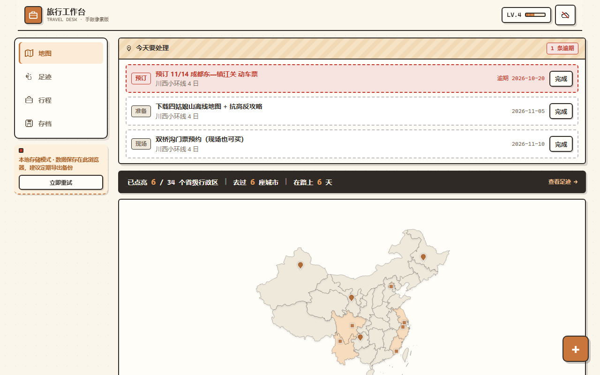

# 旅行工作台 · TRAVEL DESK

> 装得下整张中国地图的旅行手账：去过点亮、种草标记、行程规划、交通深链、成就体系。
> 单文件 HTML，零外部依赖，离线可用。

以中国地图为视觉锚点的个人旅行管理工具。去过的省份自动点亮、种草的目的地用虚线省界与图钉标记、每座城市都配得上一句手账体记忆。



## 功能特性

| 模块 | 能力 |
|---|---|
| 🗺️ **足迹地图** | 34 个省级行政区点亮（去过 = 焦糖色阶 / 想去 = 虚线省界 + 省会图钉 / 未去 = 浅灰）；悬停轻量浮层、点击底部抽屉、同城多次到访合并计数 |
| 📖 **足迹库** | 关键词搜索（城市 / 记忆 / 标签）、省份 / 标签 / 年份筛选、整卡点击编辑、多选批量打标签与删除 |
| 🧳 **行程规划** | 三种新建模板（空白 / 周末短途 / 跨省长线）、逐小时计划、大行程分页按需加载、跨城交通自动生成 12306 / 携程 / 去哪儿搜索深链、任务清单与行前简报、完成行程一键沉淀为足迹候选 |
| 📌 **想去清单** | 地图标记 + 首页旅行者卡集中管理（定位到地图 / 一键取消） |
| 🎮 **游戏化** | 经验值与升级（新足迹 +10 / 完成任务 +15 / 完成行程 +50 / 成就 +30）、像素飘字、9 枚成就（含隐藏成就「翻书人」）、存档快照（自动 + 一键，保留最近 10 版）、旅行者卡片长图导出 |
| ⌨️ **效率** | 键盘快捷键（`1-4` 切 Tab / `/` 搜索 / `n` 快记 / `Esc` 关弹层）、地图页悬浮快记按钮 |

## 快速开始

**直接使用**：下载 `index.html`，双击用浏览器打开即可。所有数据保存在浏览器 localStorage，支持 JSON 导出 / 导入 / 清空。

**在线使用**：访问 GitHub Pages 部署的在线版本（见仓库 About 右侧链接）。

## 本地开发

```bash
# 组装产物（src/ → index.html）
python3 src/assemble.py

# 安装测试依赖
cd tests && npm install && cd ..

# 运行测试（六套件，共 157 项）
export CHROMIUM_PATH=/path/to/your/chromium   # 或先执行 npx playwright install chromium
cd tests
node smoke_test.js      # 42 项：首屏 / 地图 / 核心交互
node audit_test.js      # 12 项：空态 / XSS / 边界
node regress_test.js    # 25 项：历史缺陷回归
node interact_test.js   # 47 项：交互优化专项
node a11y_test.js       # 24 项：键盘可达 / 焦点管理 / 对比度
node visual_test.js     #  7 项：设计令牌 / 布局不变量 + 基线截图
```

## 部署到 GitHub Pages

1. Fork 或 Push 本仓库到你的 GitHub 账号
2. 仓库 **Settings → Pages → Source** 选择 `main` 分支根目录（`/`）
3. 一分钟後访问 `https://<你的用户名>.github.io/<仓库名>/`

## 数据说明

- **存储**：全部数据在浏览器 localStorage（键前缀 `td_`），写操作防抖 300ms 落盘，刷新不丢
- **备份**：「存档」页提供导出 JSON / 导入恢复 / 一键清空（二次确认）
- **迁移**：换设备 = 导出 JSON → 新设备导入
- **隐私**：无任何网络请求（除 12306 / 携程 / 去哪儿 / 中国天气网 的业务深链为点击时跳转），不收集任何数据

## 技术栈

- 原生 JavaScript（ES5 风格，无构建链）、内联 CSS
- [ECharts 5.5.1](https://echarts.apache.org/)（Apache-2.0）内联本地化
- 中国省级行政区 GeoJSON（自然资源部标准地图服务 · 高德 DataV）内联，坐标 4 位小数瘦身
- 图标全部为内联 SVG path，emoji 仅作装饰元素
- 测试：Playwright（六套件 157 项，覆盖冒烟 / 审计 / 回归 / 交互 / 无障碍 / 视觉基线）

## 目录结构

```
├── index.html               # 组装产物（GitHub Pages 托管入口，可直接分发）
├── src/
│   ├── part_head.html       #   CSS 与 meta
│   ├── part_body.html       #   HTML 结构
│   ├── app_core.js          #   状态 / 数据层 / 派生计算 / 成就规则
│   ├── app_map.js           #   ECharts 地图 / 省份面板 / 悬浮卡
│   ├── app_ui.js            #   首页 / 足迹库 / 表单 / 弹层焦点管理
│   ├── app_ui2.js           #   行程 / 存档 / 快捷键 / 启动
│   ├── echarts.min.js       #   ECharts 5.5.1（内联）
│   ├── china_geo.json       #   省级行政区 GeoJSON 源数据
│   └── assemble.py          #   组装脚本（内联全部资源为单文件）
└── tests/
    ├── *_test.js            #   六套件测试
    ├── visual_baseline/     #   视觉基线截图
    └── package.json         #   测试依赖（playwright-core）
```

## 设计约定

- **配色**：奶油纸面 `#FBF6EC` + 焦糖主色 `#C8763C` + 墨色线框 `#2F2A26`，全部经 CSS 变量（语义令牌）管理
- **字体**：系统字体栈；等宽场景用 `ui-monospace` 栈
- **响应式**：桌面端（≥900px）左侧固定侧边栏 + 右侧内容列；移动端底部 Tab + 悬浮快记按钮，触控目标 ≥44px
- **无障碍**：全部可点区域支持键盘（Enter / Space）、弹层焦点约束与归还、`:focus-visible` 品牌焦点环、次要文字对比度 ≥3:1、`prefers-reduced-motion` 降级
- **性能**：渲染函数统一签名守卫（内容未变不重建 DOM）、地图 merge 更新、大行程分页、搜索防抖

## 许可

[MIT](LICENSE) © 2026 ChenYiming-aaa
